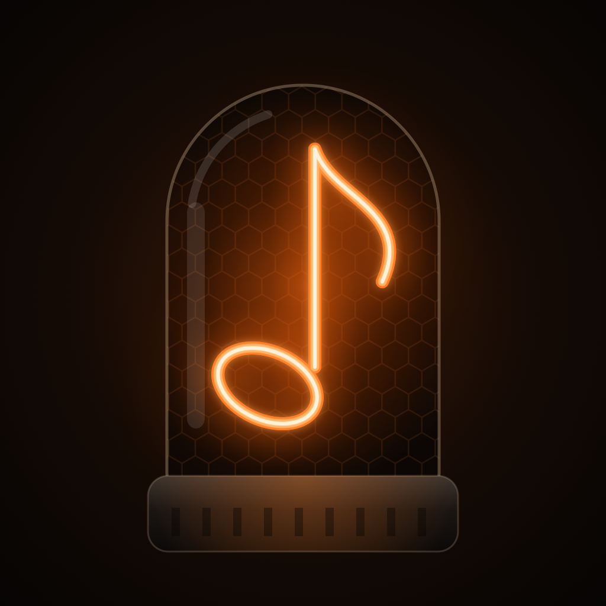
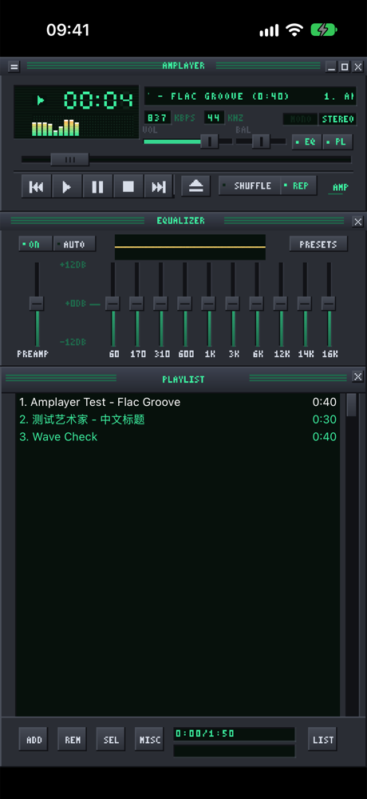
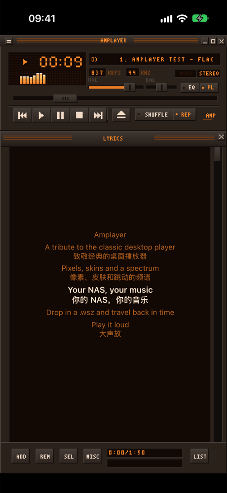
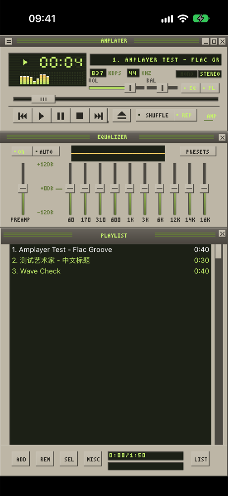
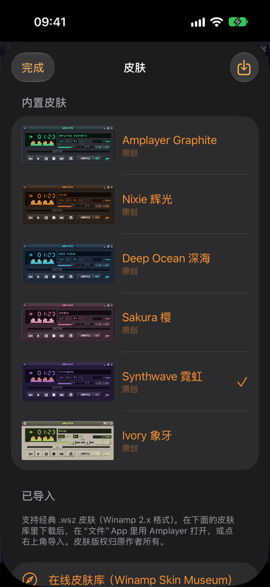

# Amplayer

**English** · [简体中文](README.zh-CN.md)



**A nostalgic, open-source iOS music player — a tribute to Winamp 2.x.**

Pixel-perfect classic windows (main window, 10-band equalizer, playlist), real `.wsz` skins, a bouncing spectrum analyzer — and it plays your music straight from your NAS, media server or network shares. Built for everyone who still remembers dragging a skin onto that little window.

Give it a try, and issues and pull requests are very welcome!

<p>
  
  
  
  
</p>

## Features

**Classic windows**
- Main window with the seven-segment clock (tap for remaining time), scrolling title, kbps/kHz, spectrum / oscilloscope, seek, volume, balance, shuffle and repeat (repeat-one shows a small “1”).
- 10-band equalizer with preamp, 19 presets and the response curve. Double-tap a slider to reset it. AUTO remembers the equalizer for each song.
- Playlist editor: ADD / REM / SEL / MISC / LIST menus, sort, reverse, randomize, remove duplicates, M3U / PLS import and export. Tap a song to play it; long-press to move it, multi-select, see track info or download it for offline use.
- Title bar: the top-left button opens a side menu with everything else, `_` toggles mini mode, and `□` cycles to the next skin.

**Sound effects**
- One-tap effects on top of the classic equalizer: Bass Boost, Clear Vocals, 3D Surround, 8D Orbit, Concert, KTV, Studio, Vinyl, Lo-Fi, EDM and Night.
- Or fine-tune: bass, vocals and treble; reverb type and amount; echo; surround depth and speed; loudness leveling; vinyl crackle; speed (0.5–2×, pitch kept) and pitch (±12 semitones, speed kept).
- Built only with Apple's audio units, measured by offline-render tests.

**Skins**
- Load any classic Winamp 2.x `.wsz` skin. Missing bitmaps fall back to the built-in skin.
- Six original built-in skins, all drawn in code: Graphite, Nixie, Deep Ocean, Sakura, Synthwave and Ivory.
- A link to the [Winamp Skin Museum](https://skins.webamp.org), which has 70,000+ skins. Open a downloaded `.wsz` from the Files app to import it.

**Sources**

| Source | Notes |
|---|---|
| Local files | Files app › Amplayer, or import from Files |
| WebDAV | Including Alist / OpenList (turns most cloud drives into WebDAV), Synology WebDAV Server and Nextcloud |
| SMB 2/3 | Windows shares and most NAS devices |
| Subsonic / OpenSubsonic | Navidrome, Airsonic, Gonic, Ampache |
| Jellyfin / Emby | Libraries, albums, artists and folders |
| Synology DSM | IP, domain or **QuickConnect ID**. File Station browses every shared folder without needing an index; Audio Station adds albums and playlists |
| UPnP / DLNA | The media server built into almost every NAS |

Bonjour and SSDP find SMB, WebDAV and DLNA servers on your local network automatically.

**Playback**
- MP3, AAC/M4A, ALAC, FLAC, **APE** (built-in Monkey's Audio decoder), WAV, AIFF, CAF and Opus (in CAF).
- Gapless playback when the next track is already cached and has the same format.
- Network tracks are cached with a download progress indicator, and the next track is prefetched. Offline downloads are supported.
- Background audio, Lock Screen and Control Center, headset controls, and resume after interruptions.
- Sleep timer (15–90 minutes, or stop after the current song) and an AirPlay / Bluetooth output picker in the side menu.

**Lyrics**
- Tap the playlist title bar to switch between the playlist and synced lyrics. The current line is highlighted and auto-scrolls, and tapping a line seeks to it.
- Lyrics come from, in order: a `.lrc` file next to the song (UTF-8 or GBK), the Synology / Navidrome lyrics APIs, embedded tags, and finally [LRCLIB](https://lrclib.net) online. You can also search LRCLIB manually and pick a result.
- Traditional Chinese lyrics can be shown as Simplified Chinese.

**Library**
- Scan sources into a searchable library, organized by songs, artists and albums.

## Try it

**TestFlight (public beta):** https://testflight.apple.com/join/tkH6ZD3E. Install TestFlight on your iPhone and open the link. The App Store release is in review.

You can also build it yourself:

1. You need a Mac with **Xcode 16 or later** (tested with Xcode 27) and [XcodeGen](https://github.com/yonaskolb/XcodeGen) (`brew install xcodegen`). The app runs on iOS 17 or later.
2. Clone the repo and set your signing team:
   ```sh
   git clone https://github.com/ggttol/amplayer.git && cd amplayer
   cp Config/Signing.local.xcconfig.example Config/Signing.local.xcconfig   # fill in DEVELOPMENT_TEAM
   xcodegen generate
   open Amplayer.xcodeproj
   ```
3. Choose your iPhone or a simulator and press Run. A free Apple ID works too, but the app has to be reinstalled every 7 days.

To play music from cloud drives (Aliyun, Baidu, 115, Quark…), run [Alist / OpenList](https://github.com/OpenListTeam/OpenList) and add it as a WebDAV source.

## Project layout

```
App/                      SwiftUI app
  Skin/                   Classic windows: sprite rendering, sliders, visualizer, lyrics panel
  Screens/                Sources, browser, library, skins, settings, side menu
Packages/AmplayerKit/
  AmplayerCore            Tracks, play queue, M3U/PLS, equalizer, LRC parser
  AmplayerAudio           AVAudioEngine player, 10-band EQ, vDSP spectrum, tag reader, APE streaming, gapless
  MonkeysAudio            Monkey's Audio SDK (C++) with a small C API
  AmplayerSources         Source protocols, Keychain, LAN discovery, online lyrics
  AmplayerCache           Download cache, LRU, offline files, progress
  AmplayerSkin            .wsz parser (own ZIP reader), sprite tables, built-in skins
  AmplayerKit             Playback controller, library, source and skin management
UITests/                  XCUITest end-to-end tests
Tools/                    Test servers, UI test runner, icon generator
```

## Tests

```sh
(cd Packages/AmplayerKit && swift test)    # unit tests on macOS
Tools/ui-test.sh                           # UI tests in the simulator (starts a WebDAV test server in Docker)
Tools/test-servers.sh && (cd Packages/AmplayerKit && AMP_LIVE=1 swift test)   # WebDAV, DLNA, SMB, Navidrome, Jellyfin in Docker
```

Some tests also run against real services, with credentials passed in environment variables:
- **A real Synology NAS**: `AMP_SYNO_URL`, `AMP_SYNO_USER`, `AMP_SYNO_PASS`, `AMP_SYNO_QC`.
- **LRCLIB**: `AMP_LIVE_LYRICS=1`.
- **A real `.wsz` skin**: `AMP_TEST_WSZ`.

In debug builds, the UI can be driven with launch arguments; see `App/DebugHooks.swift`. In-app, **Settings › Playback log** records track changes, errors and audio interruptions. Including it in a bug report helps a lot.

## License

The code is released under the [MIT License](LICENSE). Third-party components keep their own licenses: the Monkey's Audio SDK is BSD, and AMSMB2 / libsmb2 are LGPL and dynamically linked. See [THIRD_PARTY_LICENSES.md](THIRD_PARTY_LICENSES.md).

Amplayer is a fan-made tribute. It is not affiliated with Winamp, Nullsoft or Llama Group. The built-in skins and the icon are original work. Imported `.wsz` skins belong to their authors.
