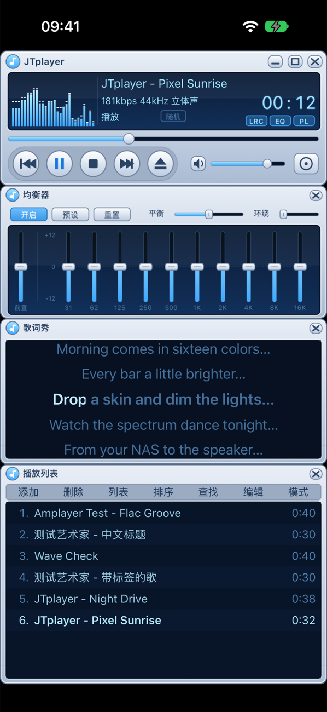
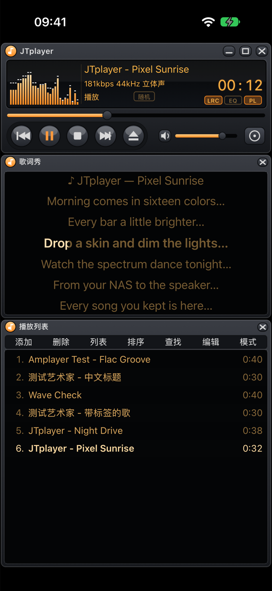
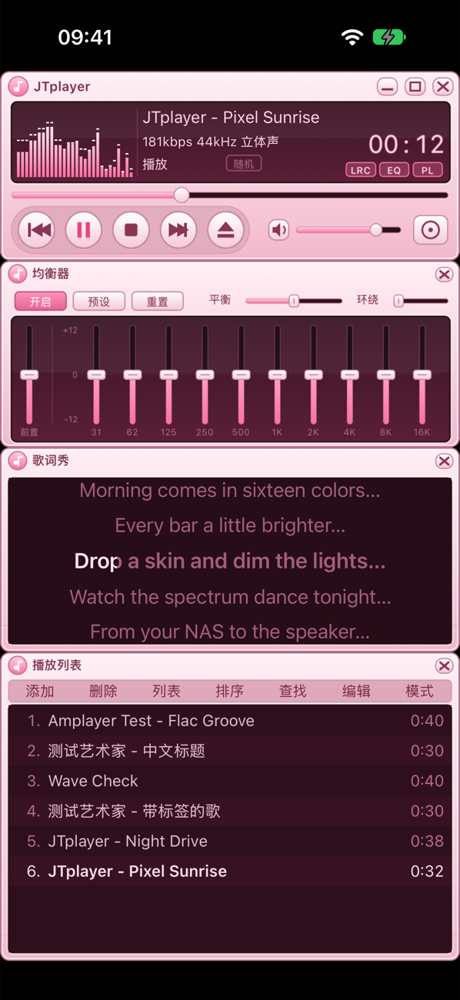

# JTplayer

[English](README.md) · **简体中文**


**一款致敬千千静听的怀旧开源 iOS 音乐播放器。**

还记得那个蓝色的主控窗口、卡拉 OK 一样逐字变色的“歌词秀”、吸附在一起的均衡器和播放列表吗？JTplayer 把它们搬到了 iPhone 上，还能加载千千静听格式的 `.skn` 皮肤。音乐可以直接从 NAS、媒体服务器和局域网共享里播放。

欢迎大家试用，有问题或想法请提 Issue，也欢迎 PR！

<p>
  
  
  
  
</p>

## 功能

**经典窗口**
- **主控窗口**：频谱 / 示波器（点按切换）、滚动的歌曲信息、码率和声道、LED 时间（点按切换剩余时间，暂停时闪烁）、进度、音量、静音。
- **五种播放模式**：单曲播放、单曲循环、顺序播放、循环播放、随机播放，点主窗口上的模式按钮依次切换。
- **歌词秀**：同步歌词逐行滚动，当前这句按时间从左到右变色，和当年的卡拉 OK 效果一样。点某一句跳到那里，长按可以在线搜索或导入 `.lrc`。
- **均衡器**：开启、预设、重置，平衡、环绕、前置放大和 31 Hz–16 kHz 十个频段。
- **播放列表**：添加、删除、列表、排序、查找、编辑、模式七个菜单，和原版一样。点歌名直接播放；长按可以调整顺序、多选、看曲目信息、离线下载。
- 主窗口上的 LRC / EQ / PL 按钮开关各个窗口，窗口依次吸附在主窗口下面。迷你模式只留主窗口。

**皮肤**
- 能加载千千静听格式的 `.skn` 皮肤（`Skin.xml` version="2"）：主控、歌词、均衡器、播放列表窗口的位图、四态按钮、滑块、LED 数字、九宫格拉伸，以及 Lyric.xml、Playlist.xml、Visual.xml 里的配色。GBK 和 UTF-8 编码都认。
- 皮肤里没有的窗口，用默认皮肤的窗口补上。
- 内置 5 套原创皮肤，全部用代码绘制：静听蓝、炫酷黑、樱花粉、翡翠绿、金属银。
- 在“文件”App 里点开 `.skn` 就能导入。

**音效**
- 在均衡器之上叠加一键音效：超重低音、清澈人声、3D 环绕、8D 旋转、演唱会、KTV、录音棚、黑胶唱机、Lo-Fi、电音舞曲、夜间轻柔。
- 也可以自己调：低音、人声、高音，混响，回声，环绕，响度均衡，黑胶底噪，变速（不变调）和变调（不变速）。

**音乐来源**

| 来源 | 说明 |
|---|---|
| 本机文件 | “文件”App › JTplayer，或从“文件”导入 |
| WebDAV | 包括 Alist / OpenList（能把大部分网盘转成 WebDAV）、群晖 WebDAV Server、Nextcloud |
| SMB 2/3 | Windows 共享和各类 NAS |
| Subsonic / OpenSubsonic | Navidrome、Airsonic、Gonic、Ampache |
| Jellyfin / Emby | 媒体库、专辑、艺术家、文件夹 |
| 群晖 DSM | 可填 IP、域名或 QuickConnect ID；File Station 浏览所有共享文件夹，Audio Station 另外提供专辑和播放列表 |
| UPnP / DLNA | 几乎所有 NAS 都自带的媒体服务器 |

局域网里的 SMB、WebDAV、DLNA 服务会自动发现。

**播放**
- 支持 MP3、AAC/M4A、ALAC、FLAC、APE（内置 Monkey's Audio 解码器）、WAV、AIFF、CAF、Opus（CAF 封装）。
- 下一首已经缓存、并且格式相同时，切歌无缝衔接。网络曲目先缓存再播放，也可以离线下载。
- 支持后台播放、锁屏和控制中心、耳机线控、定时关闭、AirPlay / 蓝牙输出。
- 歌词依次从歌曲旁边的同名 `.lrc`（UTF-8 和 GBK 都行）、服务器歌词接口、文件内嵌歌词里找，都没有时在线查（[LRCLIB](https://lrclib.net)、网易云音乐、QQ 音乐和酷狗一起搜，挑最接近的同步歌词）。纯文本歌词会跟着播放进度滚动。
- 不播放、在后台或关掉可视化时，界面停止刷新、不做频谱计算，暂停一会儿后音频引擎也会休眠，不会让手机发烫。

## 试用

**TestFlight 公开测试**：https://testflight.apple.com/join/sKFPMY7Y 。在 iPhone 上装好 TestFlight，打开链接就能安装。App Store 正式版正在审核中。

## 自己编译

1. 需要一台 Mac，装好 **Xcode 16 或更高版本** 和 [XcodeGen](https://github.com/yonaskolb/XcodeGen)（`brew install xcodegen`）。App 支持 iOS 17 及以上。
2. 克隆仓库，配置签名团队：
   ```sh
   git clone https://github.com/ggttol/jtplayer.git && cd jtplayer
   cp Config/Signing.local.xcconfig.example Config/Signing.local.xcconfig   # 填入 DEVELOPMENT_TEAM
   xcodegen generate
   open JTplayer.xcodeproj
   ```
3. 选你的 iPhone 或模拟器，点运行。

## 工程结构

```
App/
  TT/                     千千静听式窗口：主控、歌词秀、均衡器、播放列表，皮肤控件和皮肤管理
  Screens/                来源、浏览、曲库、音效、设置、侧边菜单
Packages/AmplayerKit/     播放内核（与姊妹项目 Amplayer 共用）
  TTSkin                  .skn 解析与加载、可拉伸窗口布局、内置皮肤绘制
  AmplayerCore            曲目、播放队列、M3U/PLS、均衡器、LRC 解析
  AmplayerAudio           AVAudioEngine 播放器、均衡器与音效链、频谱、APE 解码、无缝衔接
  AmplayerSources         各协议来源、Keychain、局域网发现、在线歌词
  AmplayerCache           下载缓存、离线文件
  AmplayerKit             播放总控、曲库、来源管理
UITests/                  XCUITest 端到端测试
Tools/                    测试服务器、界面测试脚本、图标生成
```

## 测试

```sh
(cd Packages/AmplayerKit && swift test)    # 单元测试（含 .skn 解析、内置皮肤、音效链离线渲染）
Tools/ui-test.sh                           # 模拟器界面测试（会用 Docker 起一个 WebDAV 测试服务器）
```

## 许可

代码以 [MIT 许可证](LICENSE) 开源。第三方组件沿用各自的许可：Monkey's Audio SDK 是 BSD；AMSMB2 / libsmb2 是 LGPL，以动态库方式链接。详见 [THIRD_PARTY_LICENSES.md](THIRD_PARTY_LICENSES.md)。

JTplayer 是爱好者的致敬作品，与千千静听、百度没有任何关系，“千千静听”是其权利人的商标。App 不内置任何原版皮肤或素材：内置皮肤和图标都是原创，导入的 `.skn` 皮肤版权归原作者所有。
